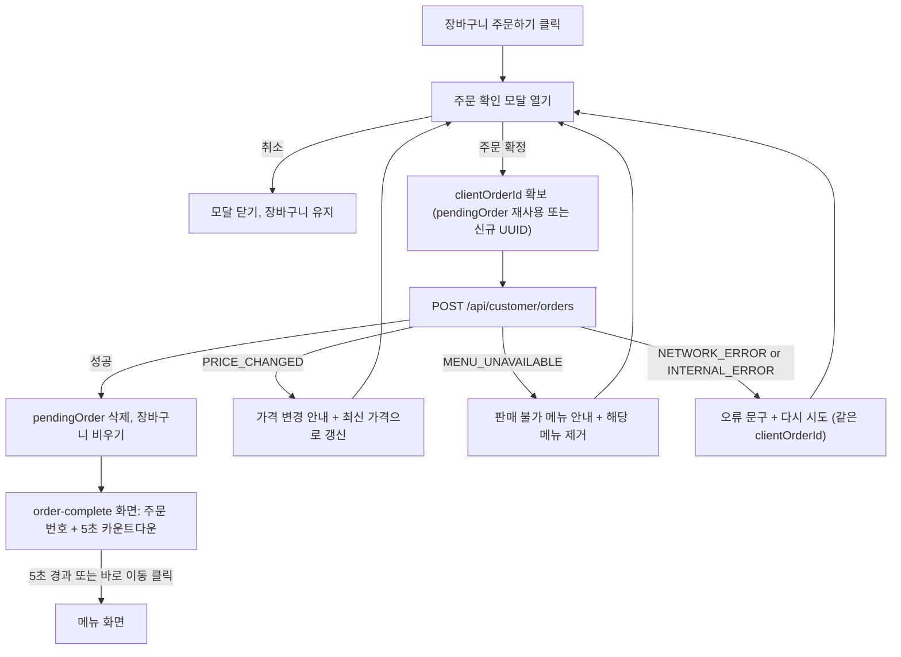

# Business Logic Model - frontend (Unit 1)

화면 흐름, 상태 전이, 데이터 흐름을 정의합니다. 규칙의 구체 값은 `business-rules.md`, 데이터 형태는 `domain-entities.md`를 참고합니다.

## 1. 라우트 맵

| 경로 | 화면 | 접근 조건 |
|---|---|---|
| `/` | `/customer`로 리다이렉트 | - |
| `/customer` | `/customer/menu`로 리다이렉트 | - |
| `/customer/setup` | 테이블 초기 설정 | 항상 접근 가능 |
| `/customer/menu` | 메뉴 + 장바구니 (기본 화면) | 테이블 인증됨 |
| `/customer/orders` | 현재 세션 주문 내역 | 테이블 인증됨 |
| `/customer/order-complete` | 주문 완료(5초 카운트다운) | 인증됨 + 주문 번호 상태 있음, 없으면 메뉴로 |
| `/admin` | `/admin/dashboard`로 리다이렉트 | - |
| `/admin/login` | 관리자 로그인 | 비인증 |
| `/admin/dashboard` | 실시간 주문 대시보드 | 관리자 인증됨 |
| `/admin/tables` | 테이블 관리 | 관리자 인증됨 |
| `/admin/menus` | 메뉴 관리 | 관리자 인증됨 |

가드 규칙:
- 고객 보호 경로: `status = loading`이면 로딩 화면, `needs_setup`이면 `/customer/setup`, `error`이면 재시도 화면.
- 관리자 보호 경로: 비인증이면 `/admin/login`으로 보내며 원래 경로를 `returnTo`로 보관. 이미 인증된 상태에서 `/admin/login`에 오면 대시보드로.

---

## 2. 고객 흐름

### 2.1 앱 시작과 자동 로그인 (US-C1.1, US-E3)

```
앱 시작
  |
  v
저장된 자격 증명 있음?
  |-- 아니오 --> needs_setup --> /customer/setup
  |-- 예 --> status=loading --> POST /api/customer/auth/login
                |-- 성공 --> authenticated --> /customer/menu
                |-- INVALID_CREDENTIALS --> needs_setup (사유 표시, 매장/테이블 번호 미리 채움)
                |-- NETWORK_ERROR/INTERNAL_ERROR --> error (5초마다 자동 재시도 + 수동 버튼)
```

초기 설정(`/customer/setup`):
1. 매장 식별자, 테이블 번호, 비밀번호(숫자 4자리) 입력 -> 클라이언트 검증
2. `POST /api/customer/auth/login` 호출
3. 성공 시에만 localStorage에 자격 증명 저장, 토큰을 메모리에 보관, 현재 테이블과 다른 `tableKey`의 장바구니는 버림 -> `/customer/menu`
4. 실패 시 오류 문구 표시 (`INVALID_CREDENTIALS`, 네트워크 오류 등), 저장하지 않음

토큰 만료 처리(모든 고객 API 공통):
```
API 호출 -> UNAUTHORIZED
  -> 저장된 자격 증명으로 재로그인 (1회)
       |-- 성공 -> 원래 요청 1회 재시도
       |-- 실패 -> needs_setup
```

### 2.2 메뉴 탐색 (US-C2.1, US-C2.2)

1. `GET /api/customer/menus` -> `CategoryMenus[]` (서버가 정한 카테고리 순서와 메뉴 노출 순서)
2. 레이아웃(태블릿 가로 3단): 좌측 카테고리 사이드바 / 중앙 메뉴 카드 그리드 / 우측 장바구니 패널
3. 사이드바 항목 클릭 -> 해당 카테고리 섹션으로 부드럽게 스크롤. 스크롤 위치에 따라 현재 카테고리가 사이드바에서 강조 (scroll-spy)
4. 메뉴 카드: 이미지, 메뉴명, 설명, 가격, "담기" 버튼. 카드 전체 또는 버튼 터치로 담기 (버튼이 주 동작)
5. 메뉴가 갱신될 필요가 있을 때(주문 실패 `PRICE_CHANGED` 등) 메뉴 쿼리를 재조회한다. 평상시에는 화면 진입 시와 창 포커스 복귀 시 재조회한다.

### 2.3 장바구니 (US-C3.1~C3.3)

상태: `CartProvider`(Context + reducer) + localStorage 동기화.

| 액션 | 전이 |
|---|---|
| `ADD(menu)` | 있으면 quantity+1 (최대 20), 없으면 {quantity:1} 추가 |
| `INCREASE(menuId)` | quantity+1 (최대 20) |
| `DECREASE(menuId)` | quantity-1, 0이 되면 제거 |
| `REMOVE(menuId)` | 제거 |
| `CLEAR` | 전체 비움 |
| `REFRESH_PRICES(prices)` | 해당 menuId의 unitPrice 갱신 |
| `REMOVE_MANY(menuIds)` | 여러 항목 제거 |

모든 액션 후 `totalAmount`, `totalCount` 재계산, localStorage 저장, `cartSignature`가 바뀌면 `pendingOrder` 삭제.

### 2.4 주문 생성 (US-C4.1, C4.2, E1, E2)



텍스트 대안:
1. 주문하기 -> 확인 모달 -> 주문 확정
2. 요청 성공 -> 장바구니 비움 -> 완료 화면(5초) -> 메뉴 화면
3. 요청 실패 -> 모달에 오류 표시, 장바구니 유지, 재시도 가능. 가격/메뉴 변경은 갱신 후 재확인

### 2.5 주문 내역 (US-C5.1, C5.2)

1. `/customer/orders` 진입 -> `useInfiniteQuery`로 `GET /api/customer/orders?page=0&size=10`
2. 목록 끝 sentinel이 보이면 `hasNext`일 때 다음 페이지 요청
3. 화면이 보이는 동안 5초마다 로드된 모든 페이지 재조회 (상태 변경 반영)
4. 각 주문: 주문 번호, 주문 시각, 메뉴/수량 목록, 금액, 상태 배지
5. 실패 시 이전 데이터 유지 + 안내 문구, 다음 주기에 재시도

---

## 3. 관리자 흐름

### 3.1 로그인과 세션 (US-A1.1, A1.2, E4, E9)

```
/admin/login 제출
  -> POST /api/admin/auth/login
       |-- 성공 --> {accessToken, expiresAt} 저장 --> returnTo 또는 /admin/dashboard
       |-- INVALID_CREDENTIALS --> 오류 문구
       |-- ACCOUNT_LOCKED --> 버튼 잠금 + retryAfterSeconds 카운트다운
       |-- VALIDATION_ERROR / 네트워크 오류 --> 오류 문구

앱 시작 / 새로고침
  -> 저장된 토큰 있고 expiresAt 미래 --> 인증 복원 (만료 타이머 설정)
  -> 없거나 만료 --> 삭제 후 로그인 화면

만료 타이머 도달 또는 임의 API UNAUTHORIZED
  -> 토큰 삭제, SSE 종료, 캐시 비우기, returnTo 보관 --> /admin/login (만료 안내)
```

### 3.2 대시보드와 실시간 (US-A2.1~A2.5, E6)

1. 진입 시 `GET /api/admin/dashboard` -> `TableSummary[]` (번호 오름차순, 각 카드 최신 3건 `orders`)
2. 동시에 SSE 연결 시작 (`useEventStream`)
3. SSE 이벤트 -> 대시보드 쿼리 무효화 -> 재조회. `order_created`면 `UnseenOrders`에 추가
4. 카드 표시: 테이블 번호, 총 주문액, 주문 개수, 최신 3건 미리보기(주문 번호, 시각, 메뉴 요약, 금액, 상태 배지), 버튼: 과거 내역, 이용 완료
5. 테이블 필터 드롭다운(전체 / 테이블 N):
   - 선택 시 `GET /api/admin/dashboard?table=N` -> 해당 테이블 카드 1개가 현재 세션의 전체 주문을 모두 표시
   - 카드 헤더의 "전체 보기" 버튼도 같은 필터를 설정
   - "전체"로 되돌리면 모든 카드(각 3건)
6. 주문 행 클릭 -> `OrderDetailModal` (`GET /api/admin/orders/{id}`): 테이블 번호, 주문 번호, 시각, 전체 메뉴/수량/단가/소계, 총 금액, 상태, 상태 변경 버튼, 삭제 버튼
7. 카드 헤더 또는 주문 행 클릭 시 해당 테이블의 신규 주문 강조 해제
8. 연결 상태 표시와 수동 새로고침 버튼 제공

### 3.3 상태 변경 (US-A2.4, E5)

```
OrderDetailModal 또는 카드 내 "다음 단계" 클릭
  -> PATCH /api/admin/orders/{id}/status { status: next }
       |-- 성공 --> 대시보드/상세 쿼리 무효화
       |-- INVALID_TRANSITION --> "이미 상태가 변경되었어요" + 해당 주문 재조회
       |-- 기타 오류 --> 오류 토스트
```

### 3.4 주문 삭제 (US-A3.2, E8)

```
삭제 클릭 -> 확인 팝업
  -> 확인 -> DELETE /api/admin/orders/{id}
       |-- 성공 --> 성공 토스트, 상세 모달 닫기, 대시보드 재조회 (총 주문액은 서버 재계산 값 표시)
       |-- NOT_FOUND --> "이미 삭제된 주문이에요" + 재조회
       |-- 기타 오류 --> 실패 토스트 (표시 데이터 변화 없음)
```

### 3.5 이용 완료 (US-A3.3, E8)

```
이용 완료 클릭 -> 확인 팝업
  -> 확인 -> POST /api/admin/tables/{id}/end-session
       |-- 성공 --> 성공 토스트, 카드 합계 0원, 주문 비움 (재조회)
       |-- NO_ACTIVE_SESSION --> "이미 이용 완료된 테이블이에요" + 재조회
       |-- 기타 오류 --> 실패 토스트
```
세션 시작은 서버가 첫 주문 시 자동으로 수행하며 프론트엔드에서 별도 동작은 없다. 세션이 없는 테이블 카드는 "비어 있음" 표시, 이용 완료 버튼 비활성.

### 3.6 과거 내역 (US-A3.4)

1. 카드의 "과거 내역" -> `TableHistoryModal` 열기 -> `GET /api/admin/tables/{id}/history` (필터 없음, 시간 역순)
2. 항목: 주문 번호, 주문 시각, 메뉴 목록, 총 금액, 이용 완료 시각
3. 시작일/종료일 변경 시 `?from=YYYY-MM-DD&to=YYYY-MM-DD`로 재조회
4. "닫기" -> 모달 닫고 대시보드로 복귀

### 3.7 테이블 등록 (US-A3.1)

1. `/admin/tables`: `GET /api/admin/tables` 목록 + 등록 폼
2. 제출 -> `POST /api/admin/tables` -> 성공 시 목록 갱신, 토스트, 태블릿 설정 안내 문구
3. 태블릿에서는 `/customer/setup`에 같은 매장 식별자/테이블 번호/비밀번호를 입력해 자동 로그인을 활성화한다.

### 3.8 메뉴 관리 (US-A4.1~A4.4, E7)

1. `/admin/menus`: `GET /api/admin/menus` -> 카테고리별 목록
2. 등록/수정 모달 폼 -> `POST /api/admin/menus` / `PUT /api/admin/menus/{id}` -> 성공 시 닫고 재조회, `VALIDATION_ERROR`는 필드별 표시
3. 삭제 -> 확인 팝업 -> `DELETE /api/admin/menus/{id}`
4. 위/아래 이동 -> `PUT /api/admin/menus/reorder { category, orderedIds }`

---

## 4. 가짜 API (mock) 동작 모델

`VITE_API_MODE=mock`(개발 기본값)에서 실제 ApiClient 대신 인-메모리 가짜 API 모듈이 `contracts/openapi.yaml`의 모든 경로를 구현한다. `VITE_API_MODE=real`이면 실제 fetch를 사용한다.

| 항목 | 동작 |
|---|---|
| 초기 데이터 | 샘플 메뉴(카테고리 3~4개, 메뉴 10개 이상), 테이블 1~5번(비밀번호 `1234`), 관리자 계정(매장 `demo`, 사용자 `admin`, 비밀번호 `admin1234` - 개발용 가짜 값) |
| 지연 | 요청마다 150~400ms 무작위 지연 |
| 인증 | 가짜 토큰 발급, `expiresAt` 포함. 만료/잘못된 토큰이면 `UNAUTHORIZED` |
| 잠금 | 관리자 로그인 연속 5회 실패 시 `ACCOUNT_LOCKED` + `retryAfterSeconds` (900초) |
| 주문 | 서버와 같은 규칙: 서버 가격 재계산, `PRICE_CHANGED`/`MENU_UNAVAILABLE` 재현, `clientOrderId` 중복 시 기존 주문 반환, 첫 주문 시 세션 생성 |
| 상태 전이 | 순차만 허용, 위반 시 `INVALID_TRANSITION` |
| 이용 완료 | 세션 주문을 이력으로 이동, 합계 0 |
| 실시간 | `EventTarget`/`BroadcastChannel`로 가짜 SSE 이벤트를 발행. 고객 탭과 관리자 탭을 따로 열어도 동작하도록 데이터를 localStorage(`tableorder.mock.store.v1`)에 저장하고 탭 간 동기화 |
| 오류 시뮬레이션 | 개발 중 쿼리 파라미터(예: `?mockError=network`)로 네트워크 오류/서버 오류를 강제할 수 있는 훅 제공 (US-E1, E6 수동 확인용) |
| 검증 | 입력 검증 규칙은 `business-rules.md`와 동일하게 적용해 `VALIDATION_ERROR` 재현 |

테스트(Vitest)에서는 같은 가짜 API를 사용하되 localStorage/BroadcastChannel 대신 격리된 인스턴스를 생성한다.

---

## 5. 데이터 흐름 요약

```
UI 컴포넌트
  -> 데이터 훅 (TanStack Query: useQuery / useMutation / useInfiniteQuery)
  -> ApiClient (mock 또는 real)
       - 요청: 토큰 헤더 부착, JSON 직렬화
       - 응답: 성공 -> 타입 있는 데이터, 실패 -> ApiError(code, body)
       - 401: 역할별 처리(고객: 재로그인 1회, 관리자: 로그아웃)
  -> 가짜 API 모듈 또는 FastAPI

관리자 SSE:
  useEventStream -> 이벤트 -> (쿼리 무효화 + UnseenOrders 갱신)
```

쿼리 키(초안): `['menus']`, `['customer','orders']`, `['admin','dashboard', tableFilter]`, `['admin','order', id]`, `['admin','tables']`, `['admin','history', tableId, from, to]`, `['admin','menus']`.
재시도 정책: 조회 쿼리는 네트워크 오류 시 최대 2회 지수 백오프. 변경(mutation)은 자동 재시도하지 않는다 (주문 생성은 사용자 재시도 + 같은 `clientOrderId`).
