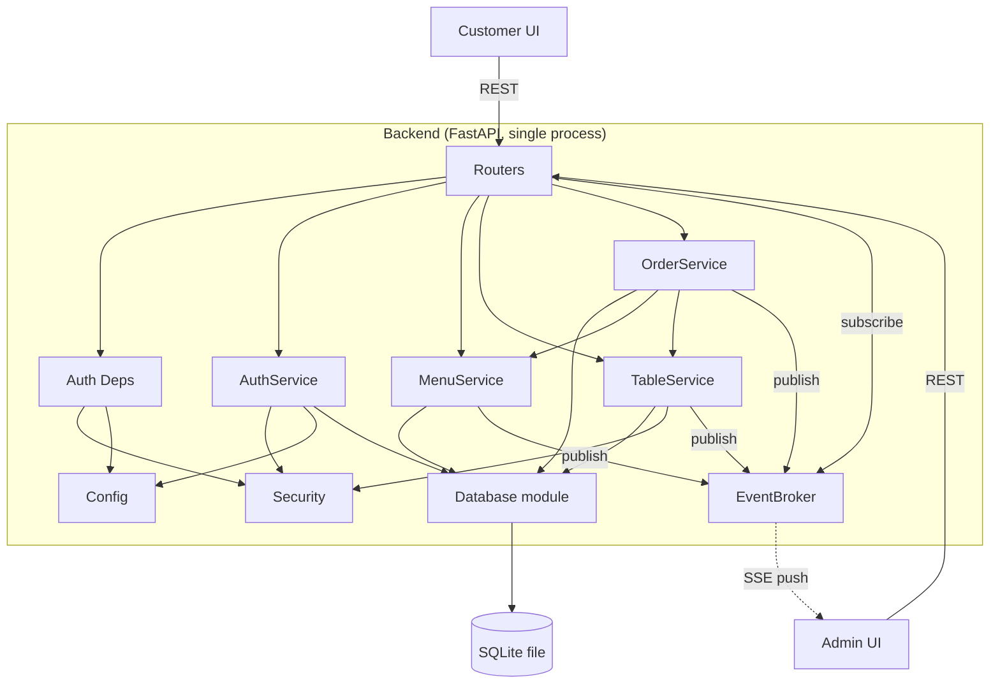

# Component Dependency (의존성과 통신 방식)

## 의존성 매트릭스 (백엔드)

행이 열을 **사용**하면 `●`.

| 사용하는 쪽 \ 사용되는 쪽 | Config | Database | Security | EventBroker | AuthService | MenuService | TableService | OrderService |
|---|---|---|---|---|---|---|---|---|
| Routers | | | | ● (SSE 구독) | ● | ● | ● | ● |
| Deps (인증 의존성) | ● | | ● | | | | | |
| AuthService | ● | ● | ● | | | | | |
| MenuService | | ● | | ● | | | | |
| TableService | | ● | ● | ● | | | | |
| OrderService | | ● | | ● | | ● (가격 조회) | ● (세션) | |
| App Entry (main) | ● | ● (스키마 초기화) | | ● (생성) | | | | |

규칙:
- 순환 의존 없음. 방향은 Router -> Service -> (Database, Security, EventBroker, Config).
- Service는 다른 Service를 최소로만 사용한다 (OrderService -> TableService, MenuService 두 곳뿐).
- Router는 Database를 직접 사용하지 않는다.

## 의존성 매트릭스 (프론트엔드)

| 사용하는 쪽 | 사용되는 쪽 |
|---|---|
| 페이지 컴포넌트 (Customer/Admin) | 데이터 훅, 컨텍스트(Auth, Cart), 공통 UI |
| 데이터 훅 (TanStack Query) | ApiClient |
| DashboardPage | `useEventStream`, `useDashboard` |
| ApiClient | 인증 컨텍스트(토큰 읽기, 401 통지) |
| Customer 모듈 <-> Admin 모듈 | 서로 의존하지 않음 (둘 다 Shared만 사용) |

## 통신 패턴

| 구간 | 방식 | 설명 |
|---|---|---|
| 고객 UI -> 백엔드 | REST/JSON (`/api/customer/*`) | 테이블 토큰(Bearer) 사용 |
| 관리자 UI -> 백엔드 | REST/JSON (`/api/admin/*`) | 관리자 토큰(Bearer) 사용 |
| 백엔드 -> 관리자 UI | SSE (`/api/admin/events`) | 변경 이벤트 푸시, 수신 시 재조회 |
| 고객 UI 상태 갱신 | 폴링 5~10초 | 주문 내역 조회 반복 |
| Service -> EventBroker | 인-프로세스 호출 | 커밋 후 publish |
| Service -> SQLite | `sqlite3` 직접 SQL | 요청 단위 연결, 짧은 트랜잭션 |

## 컴포넌트 관계도

### Mermaid



### 텍스트 대안

```
Customer UI --REST--> Routers
Admin UI    --REST--> Routers
Admin UI    <--SSE--- EventBroker (via admin_orders router)

Routers   -> Auth Deps, AuthService, MenuService, TableService, OrderService, EventBroker(subscribe)
Auth Deps -> Security, Config
AuthService  -> Security, Config, Database
MenuService  -> Database, EventBroker(publish)
TableService -> Database, Security, EventBroker(publish)
OrderService -> Database, MenuService, TableService, EventBroker(publish)
Database  -> SQLite file
```

## 데이터 흐름

### 주문 생성 -> 관리자 화면 반영

```
Customer UI -> POST /api/customer/orders
  -> customer_orders router (require_table)
  -> OrderService.create_order
       -> MenuService (가격 조회)
       -> TableService.get_or_start_session
       -> SQLite (트랜잭션 커밋)
       -> EventBroker.publish(order_created)
  <- 응답(주문 번호) -> Customer UI

EventBroker -> SSE stream -> Admin UI
  -> 대시보드 쿼리 무효화 -> GET /api/admin/dashboard -> 카드 갱신/강조
```

### 이용 완료 (세션 종료)

```
Admin UI -> POST /api/admin/tables/{id}/end-session
  -> TableService.end_session
       -> SQLite 트랜잭션: 주문 -> 이력 이관, 세션 종료 기록
       -> EventBroker.publish(session_ended)
  <- 응답 -> Admin UI (카드 합계 0)
Customer UI 폴링 -> 현재 세션 주문 없음 -> 주문 내역 비어 있음
```

## 프론트엔드 모듈 의존 관계 (텍스트)

```
app (routes, providers)
  |- customer/*  -> shared (ApiClient, UI, formatKRW)
  |- admin/*     -> shared (ApiClient, useEventStream, UI, formatKRW)
shared 는 customer/admin 을 참조하지 않는다.
```
