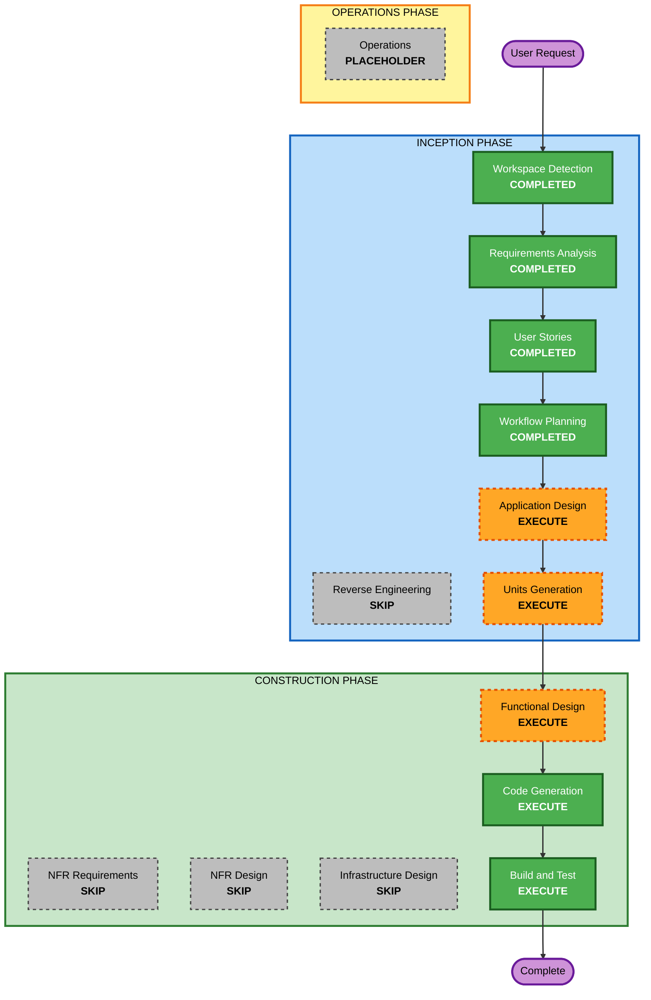

# Execution Plan

## Detailed Analysis Summary

### Transformation Scope (Brownfield Only)
N/A - Greenfield 프로젝트

### Change Impact Assessment
- **User-facing changes**: Yes - 고객용 주문 웹UI, 관리자용 관리 웹UI 신규 구축
- **Structural changes**: Yes - 프론트엔드(React) + 백엔드(FastAPI) + SQLite 구조를 새로 설계
- **Data model changes**: Yes - 메뉴, 테이블, 테이블 세션, 주문, 주문 항목, 주문 이력(OrderHistory), 로그인 시도 기록 등 신규
- **API changes**: Yes - 고객용/관리자용 REST API, 관리자 SSE 스트림 신규
- **NFR impact**: Yes (경미) - bcrypt, JWT(16시간), 로그인 잠금, SSE 2초 이내 반영, 트랜잭션 일관성. 기술 스택은 이미 확정됨

### Component Relationships (Brownfield Only)
N/A

### Risk Assessment
- **Risk Level**: Low~Medium (신규 프로젝트, 로컬 실행 전용, 소규모 단일 매장)
- **Rollback Complexity**: Easy (배포 환경 없음, 로컬 실행)
- **Testing Complexity**: Moderate (SSE 실시간, 세션 라이프사이클, 상태 전이 규칙)

## Workflow Visualization

### Mermaid Diagram



### Text Alternative

```
Phase 1: INCEPTION
- Workspace Detection ........ COMPLETED
- Reverse Engineering ........ SKIP (greenfield)
- Requirements Analysis ...... COMPLETED
- User Stories ............... COMPLETED
- Workflow Planning .......... COMPLETED (awaiting approval)
- Application Design ......... EXECUTE
- Units Generation ........... EXECUTE

Phase 2: CONSTRUCTION
- Functional Design .......... EXECUTE (per unit)
- NFR Requirements ........... SKIP
- NFR Design ................. SKIP
- Infrastructure Design ...... SKIP
- Code Generation ............ EXECUTE (per unit)
- Build and Test ............. EXECUTE

Phase 3: OPERATIONS
- Operations ................. PLACEHOLDER
```

## Phases to Execute

### 🔵 INCEPTION PHASE
- [x] Workspace Detection (COMPLETED)
- [x] Reverse Engineering (SKIPPED - greenfield)
- [x] Requirements Analysis (COMPLETED)
- [x] User Stories (COMPLETED)
- [x] Workflow Planning (IN PROGRESS)
- [ ] Application Design - EXECUTE
  - **Rationale**: 신규 컴포넌트(인증, 메뉴, 주문, 테이블 세션, 실시간 이벤트, 프론트엔드 2종)와 서비스 계층, 컴포넌트 간 의존성을 정의해야 함
- [ ] Units Generation - EXECUTE
  - **Rationale**: 백엔드 API와 프론트엔드(고객/관리자)로 나누어 단위별로 구현하면 설계와 코드 생성을 관리하기 쉬움. 예상 유닛: 백엔드 API, 고객용 웹UI, 관리자용 웹UI (최종 구성은 Units Generation에서 확정)

### 🟢 CONSTRUCTION PHASE
- [ ] Functional Design - EXECUTE (유닛별)
  - **Rationale**: 데이터 모델, 테이블 세션 라이프사이클, 주문 상태 전이 규칙, 주문 금액 서버 재계산, 이력 이관 등 업무 규칙을 상세 설계해야 함
- [ ] NFR Requirements - SKIP
  - **Rationale**: 기술 스택이 이미 확정됨(FastAPI, React, SQLite). NFR(NFR-1~8)은 requirements.md에 정의되어 있고 Functional Design과 코드 생성에서 충족 가능. Security/Resiliency/PBT 확장은 비활성
- [ ] NFR Design - SKIP
  - **Rationale**: NFR Requirements를 생략하므로 별도 NFR 패턴 설계 불필요
- [ ] Infrastructure Design - SKIP
  - **Rationale**: 로컬 실행 전용, Docker와 클라우드 배포 없음. 실행 방법은 Build and Test 지침에 포함
- [ ] Code Generation - EXECUTE (ALWAYS, 유닛별)
  - **Rationale**: 구현 계획 수립 후 코드와 테스트 생성
- [ ] Build and Test - EXECUTE (ALWAYS)
  - **Rationale**: 빌드, 단위/통합 테스트 지침 및 검증

### 🟡 OPERATIONS PHASE
- [ ] Operations - PLACEHOLDER
  - **Rationale**: 향후 배포/모니터링 워크플로용 자리

## Package Change Sequence (Brownfield Only)
N/A

## Estimated Timeline
- **남은 실행 단계**: 5개 (Application Design, Units Generation, Functional Design, Code Generation, Build and Test)
- **생략 단계**: 4개 (Reverse Engineering, NFR Requirements, NFR Design, Infrastructure Design)
- **Estimated Duration**: 단계별 승인 대화 기준 약 5~8회 상호작용. 코드 생성 분량은 유닛 수에 비례

## Success Criteria
- **Primary Goal**: MVP 범위(고객 FR-C1~C5, 관리자 FR-A1~A4)가 로컬 환경에서 동작
- **Key Deliverables**:
  - 백엔드 API(FastAPI) + SQLite 스키마
  - 고객용/관리자용 React 웹UI
  - 테스트 코드와 빌드/실행/테스트 지침
- **Quality Gates**:
  - 모든 스토리(34개)의 인수 조건 충족
  - 신규 주문이 관리자 화면에 2초 이내 반영
  - 세션 종료 후 현재 주문 0 리셋 및 과거 이력 조회 가능
